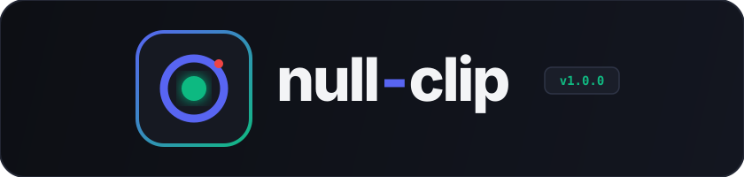
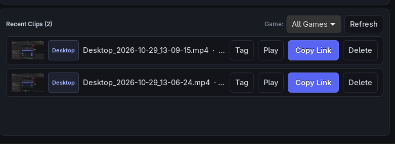
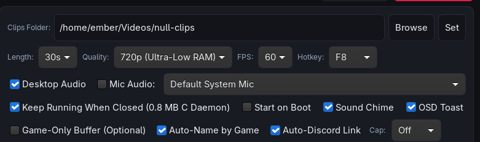
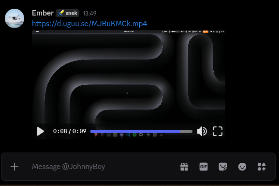

<p align="center">
  
</p>

<p align="center">
  <b>Instant-replay game clipping for Linux.</b><br/>
  Press one key to save the last 30 seconds of gameplay. No Electron bloat, no scenes, no setup.<br/>
  <sub>Uses <b>~120 MB RAM</b> with the UI closed in the background — tested on a <b>Lenovo ThinkPad T480</b>.</sub>
</p>

<p align="center">
  <a href="https://emberfr.github.io/null-clip/">Website</a> ·
  <a href="https://github.com/EmberFR/null-clip/releases/latest">Releases</a> ·
  <a href="#install">Install</a> ·
  <a href="#features">Features</a> ·
  <a href="#using-null-clip">Using null-clip</a> ·
  <a href="#why-null-clip">Why null-clip?</a> ·
  <a href="#configuration">Config</a> ·
  <a href="#troubleshooting">Troubleshooting</a>
</p>

<table align="center">
  <tr>
    <td align="center" width="50%">
      <br/>
      <sub>Home: recent clips, per-game filter pills, and one-click Discord links</sub>
    </td>
    <td align="center" width="50%">
      <br/>
      <sub>Settings: click-to-bind hotkey, Game-Only watchdog, and headless C daemon</sub>
    </td>
  </tr>
  <tr>
    <td align="center" colspan="2">
      <br/>
      <sub>Share links that auto-copy to your clipboard and play inline in Discord</sub>
    </td>
  </tr>
</table>

---

## Install

**Standalone `.AppImage` (any x86_64 Linux distro):**

Download [`null-clips.AppImage`](https://github.com/EmberFR/null-clip/releases/latest/download/null-clips.AppImage) from the [latest release](https://github.com/EmberFR/null-clip/releases/latest), make it executable, and run it:

```bash
chmod +x null-clips.AppImage
./null-clips.AppImage
```

`null-clips.AppImage` uses a FUSE-free ELF64 Type-2 header, so it launches directly on any distro and integrates cleanly with AppImage launchers like Shelly without requiring `libfuse2`.

**Arch / Manjaro / CachyOS / EndeavourOS:**

```bash
sudo pacman -S --needed gpu-screen-recorder ffmpeg wl-clipboard curl python python-gobject gtk3
git clone https://github.com/EmberFR/null-clip.git && cd null-clip && makepkg -si
```

**Ubuntu / Debian / Mint / Fedora / Nobara / other:**

```bash
# Fedora / Nobara dependencies:
sudo dnf install -y gpu-screen-recorder ffmpeg wl-clipboard curl python3 python3-gobject gtk3

# Ubuntu / Debian / Mint / Pop!_OS dependencies:
sudo apt-get update && sudo apt-get install -y ffmpeg wl-clipboard curl python3 python3-gi python3-gi-cairo gir1.2-gtk-3.0

# Install desktop entry, icon, and binary to ~/.local/bin/null-clips:
git clone https://github.com/EmberFR/null-clip.git && cd null-clip && ./install.sh
```

Launch **null-clips** from your application menu (or run `null-clips`) and press **F8** in a game. Closing the window frees the GTK3 GUI completely while the lightweight background daemon keeps watching your hotkey.

| | Update | Uninstall |
|---|---|---|
| `.AppImage` | Download newest `null-clips.AppImage` from [Releases](https://github.com/EmberFR/null-clip/releases/latest) | Remove `null-clips.AppImage` and `~/.config/autostart/null-clips.desktop` |
| Git clone (`./install.sh`) | `cd null-clip && git pull && ./install.sh` | `rm -f ~/.local/bin/null-clips ~/.local/share/applications/null-clips.desktop` |
| Arch (`PKGBUILD`) | `cd null-clip && git pull && makepkg -si` | `sudo pacman -Rns null-clips` |

---

## Features

**Free and open source.** No account, no subscription, no telemetry, and no proprietary webview wrapper. Built with native **GTK3 + Cairo** and a tiny **C hotkey daemon** under the MIT license.

**~120 MB RAM in the background.** When you close the window, the GTK3 GUI process exits completely (`0 MB` GUI overhead) and hands hotkey listening over to a compiled native C daemon (`~0.8 MB RSS`) alongside `gpu-screen-recorder`'s RAM ring buffer. Total memory usage with the UI closed in the background is **~120 MB RAM** — tested on a **Lenovo ThinkPad T480**.

**Share links that just work.** Click **Copy Discord Link** (or turn on **Auto-Share Discord** in Settings) and `null-clip` uploads the `.mp4` and copies a direct playable URL straight to both your Wayland (`wl-copy`) and X11 (`xclip` / `xsel`) clipboards. Paste into Discord and it embeds inline immediately.

**Driver-level capture.** `null-clip` runs on `gpu-screen-recorder`, talking directly to NVENC/VAAPI/Vulkan on your GPU instead of compositing a scene in userspace. Clips are kept in a hardware-encoded H.264 RAM ring buffer (`-replay-storage ram`) with near-zero CPU overhead and zero SSD wear.

**Desktop + microphone audio capture.** Record your desktop game audio and your microphone simultaneously with selectable input devices right from the main bar.

**Clips titled and tagged for you.** The moment you press your clip hotkey, `null-clip` inspects the focused window across Hyprland (`hyprctl`), Sway (`swaymsg`), X11 (`xdotool` / `xprop`), and `/proc` to tag and rename your clip automatically (e.g. `Counter-Strike-2_2026-10-29_04-12-09.mp4` or `Roblox-Sober_...mp4`). Filter your gallery by game with one click.

**Game-Only buffer watchdog.** Turn on **Game-Only Buffer** in Settings and `null-clip` automatically pauses `gpu-screen-recorder` while you are on the desktop and starts the replay buffer the moment a Steam, Proton, Sober/Roblox, or native game launches.

**Instant kernel `inotify` save detection.** Instead of polling the disk on a timer, `null-clip` hooks directly into Linux `libc` `inotify` (`IN_CLOSE_WRITE | IN_MOVED_TO`), waking up the exact millisecond `gpu-screen-recorder` finishes flushing the `.mp4`.

**Automatic folder size cap.** Set a maximum storage cap (`5 GB`, `10 GB`, or `25 GB`) and `null-clip` automatically prunes your oldest clips whenever a new save crosses your limit.

---

## Using null-clip

| Key / Action | What happens |
|---|---|
| **F8** *(default)* | Save the last 30 s (or 15 s / 60 s) of gameplay |
| **Hotkey dropdown** | Switch your global clip key (`F8`, `F9`, `F10`, `F12`, `Insert`, etc.) in the settings bar |
| **Game filter & Tag** | Filter your gallery by detected game (`All Games`, `Desktop`, `Counter-Strike 2`, `Roblox`, etc.) or re-tag any clip |
| **Play** | Open and preview the clip immediately in your system media player |
| **Copy Link** | Upload `.mp4` and copy an inline-playable Discord link to `wl-copy` / `xclip` |
| **Close window (`×`)** | Exits GTK3 (`0 MB` UI RAM) and leaves the headless C daemon + replay buffer running (`~120 MB RAM` total on a ThinkPad T480) |

Clips live in `~/Videos/null-clips/` by default. Closing the window keeps the daemon recording; reopen **null-clips** from your app launcher any time.

---

## Why null-clip?

OBS has a replay buffer, and Electron/WebView clippers exist. So why use `null-clip`?

| | OBS Replay Buffer | Electron / WebView Clippers | null-clip |
|---|---|---|---|
| **Setup time** | Launch OBS, build a scene, enable the buffer, bind a hotkey | Install heavy runtime & background web server | Launch, press **F8** |
| **Background RAM (UI closed)** | `~350–600 MB+` (GUI must stay open) | `~400–900 MB+` (Chromium / WebKit stays resident) | **~120 MB RAM** total (tested on a Lenovo ThinkPad T480; GTK3 exits completely) |
| **GPU overhead** | Re-composes a full scene continuously | Varies | Captures framebuffer directly via `gpu-screen-recorder` |
| **Global hotkey** | Needs compositor rules or X11 focus | Often blocked on Wayland | Reads `/dev/input/event*` (`evdev`) in a `~0.8 MB` C daemon + `hyprctl`/`swaymsg` |
| **Discord sharing** | Manual file upload | Local tunnel or manual upload | Built-in direct `.mp4` uploader + auto clipboard copy |
| **SSD wear** | Optional RAM buffer | Often writes temporary segments to disk | Strictly RAM-backed (`-replay-storage ram`) |

---

## Compatibility

| Compositor / Shell | | GPU | |
|---|---|---|---|
| Hyprland (Wayland) | ✅ | NVIDIA | ✅ NVENC |
| KDE Plasma (Wayland) | ✅ | AMD | ✅ VAAPI |
| GNOME (Wayland) | ✅ | Intel ( incl. ThinkPad T480 UHD 620 ) | ✅ VAAPI |
| Sway (Wayland) | ✅ | Anything else | ✅ Portal / software fallback |
| Any X11 WM / DE | ✅ | | |

`gpu-screen-recorder` is the capture backend everywhere. On Wayland compositors where direct DRM capture requires capabilities, `null-clip` automatically falls back to the XDG Desktop Portal (`-w portal`) if direct screen capture (`-w screen`) is unavailable.

---

## CLI

```text
null-clips                 Open the native GTK3 + Cairo desktop interface
null-clips --background    Start the replay buffer and headless daemon without opening the GUI
null-clips --daemon        Run the headless evdev hotkey & Game-Only watcher (~0.8 MB C daemon)
null-clips --save-clip     Trigger an immediate clip save, game-tag rename, and optional Discord upload
null-clips --quit          Stop the background daemon and all gpu-screen-recorder processes
null-clips --version       Print current version (v1.0.0)
null-clips --help          Show available CLI flags
```

When **Start on Boot** is enabled in Settings, `~/.config/autostart/null-clips.desktop` runs `null-clips --background`, so your replay buffer starts at login before GTK3 is ever imported.

---

## Configuration

`null-clip` writes `~/.config/null-clips/settings.json` on first run. Every option below is also editable live from the **Settings** tab in the GUI:

```json
{
  "outputDir": "/home/user/Videos/null-clips",
  "seconds": "30",
  "fps": "60",
  "resolution": "1280x720",
  "hotkey": "F8",
  "desktopAudio": true,
  "includeMic": true,
  "micDevice": "default_input",
  "soundEnabled": true,
  "osdNotifications": true,
  "autoShareDiscord": false,
  "autoRenameWithGame": true,
  "gameOnlyBuffer": false,
  "folderSizeCapGb": "0",
  "keepRunningClosed": true,
  "startOnBoot": false
}
```

Notes:

- `keepRunningClosed` (`true` by default) exits the GTK3 application process completely when you close the window and spawns the compiled C hotkey daemon (`~/.local/bin/null-clips-daemon`), keeping total background memory usage around **~120 MB RAM** (measured on a Lenovo ThinkPad T480).
- `gameOnlyBuffer` pauses `gpu-screen-recorder` while you are on the desktop and automatically starts the replay buffer when a known game (`Counter-Strike 2`, `Roblox (Sober)`, `Apex Legends`, `Minecraft`, `Overwatch 2`, `Marvel Rivals`, `Deadlock`, `THE FINALS`, `Elden Ring`, etc.) is detected.
- `autoShareDiscord` automatically uploads every newly saved clip in the background and copies the direct `.mp4` URL to your clipboard (`wl-copy` / `xclip`) with a desktop notification.
- `folderSizeCapGb` accepts `"0"` (unlimited), `"5"`, `"10"`, or `"25"`. When set, the oldest clips in `outputDir` are automatically deleted after a save if the folder exceeds your cap.

---

## Troubleshooting

**Hotkey not firing when the window is closed on Wayland.**  
`null-clip`'s C daemon reads `/dev/input/event*` directly so hotkeys work across every Wayland compositor and X11 window manager. Make sure your user is in the `input` group, then log out and back in:

```bash
sudo usermod -aG input $USER
```

On Hyprland and Sway, `null-clip` also registers a compositor keybind automatically via `hyprctl` / `swaymsg` so hotkeys work even before `input` group permissions take effect.

**`gpu-screen-recorder: command not found` or buffer stays stopped.**  
Install `gpu-screen-recorder` from your distro's package repositories (Arch/CachyOS: `sudo pacman -S gpu-screen-recorder`, Fedora/Nobara: `sudo dnf install gpu-screen-recorder`). Verify it is in your `PATH` with `which gpu-screen-recorder`.

**Prompted to select a screen every time the replay buffer starts.**  
Give `gpu-screen-recorder` DRM capabilities once so it can capture your display directly (`-w screen`) without invoking the Wayland portal picker:

```bash
sudo setcap cap_sys_admin+ep $(which gpu-screen-recorder)
```

**Discord link didn't copy on Wayland.**  
Install `wl-clipboard` (`sudo pacman -S wl-clipboard` / `sudo apt install wl-clipboard` / `sudo dnf install wl-clipboard`). On X11, install `xclip` or `xsel`.

**Building the standalone `.AppImage` from source.**  
Run `./build-appimage.sh` in the repository root to package `null-clips.AppImage` (`~88 KB`, FUSE-free ELF64 Type-2 header + embedded GTK3 runtime):

```bash
chmod +x build-appimage.sh && ./build-appimage.sh
```

---

## Star History

<a href="https://www.star-history.com/#EmberFR/null-clip&Date">
 <picture>
   <source media="(prefers-color-scheme: dark)" srcset="https://api.star-history.com/svg?repos=EmberFR/null-clip&type=Date&theme=dark" />
   <source media="(prefers-color-scheme: light)" srcset="https://api.star-history.com/svg?repos=EmberFR/null-clip&type=Date" />
   
 </picture>
</a>

## Credits

Created by **EmberFR** ([github.com/EmberFR](https://github.com/EmberFR)). Bug reports, game detection additions, and pull requests are welcome.

## License

[MIT](LICENSE)
